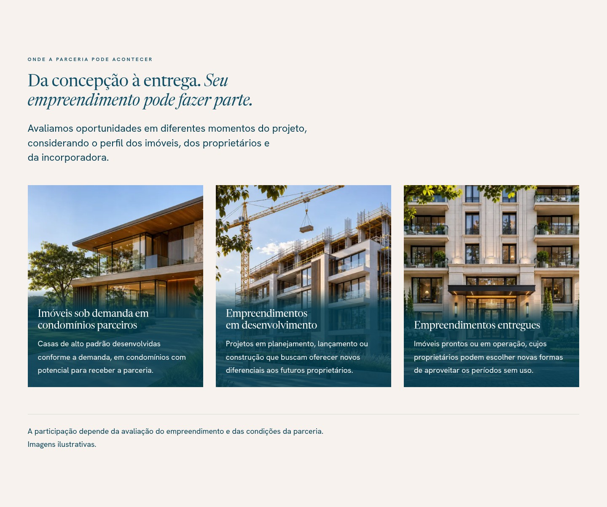

# SHP1 — revisão da seção de empreendimentos parceiros

Seção `#empreendimentos` em `/second-home-partner`, imediatamente entre Benefícios e Soluções para os proprietários.
Referências: REQ-105, `catalog` §20.2 e decisão `D-SHP-13`. Demais seções, CTAs, formulário e configuração preservados.

## Capturas reais

Build local de produção, Chromium, com fontes e fotografias carregadas. Capturas de detalhe são recortes do documento
renderizado; não são mockups. As fotografias são ilustrativas, sem identificar empreendimentos reais da Luxtory.

| Visualização | Captura |
|---|---|
| Página completa · mobile | [390 px](pagina-completa-390.jpg) |
| Página completa · desktop | [1440 px](pagina-completa-1440.jpg) |
| Seção · celular pequeno | [320 px](empreendimentos-320.jpg) |
| Seção · celular | [390 px](empreendimentos-390.jpg) |
| Seção · tablet | [768 px](empreendimentos-768.jpg) |
| Seção · desktop compacto | [1024 px](empreendimentos-1024.jpg) |
| Seção · desktop | [1440 px](empreendimentos-1440.jpg) |
| Seção · tela ampla | [1920 px](empreendimentos-1920.jpg) |

## Copy efetivamente renderizada

**Onde a parceria pode acontecer**

Da concepção à entrega. *Seu empreendimento pode fazer parte.*

Avaliamos oportunidades em diferentes momentos do projeto, considerando o perfil dos imóveis, dos proprietários e da incorporadora.

| Título | Descrição |
|---|---|
| Imóveis sob demanda em condomínios parceiros | Casas de alto padrão desenvolvidas conforme a demanda, em condomínios com potencial para receber a parceria. |
| Empreendimentos em desenvolvimento | Projetos em planejamento, lançamento ou construção que buscam oferecer novos diferenciais aos futuros proprietários. |
| Empreendimentos entregues | Imóveis prontos ou em operação, cujos proprietários podem escolher novas formas de aproveitar os períodos sem uso. |

A participação depende da avaliação do empreendimento e das condições da parceria. Imagens ilustrativas.

## Imagens e apresentação

Os três PNG 1448 × 1086 fornecidos no ZIP foram convertidos para WebP sem perda. Comparação dos buffers RGB confirmou
pixels idênticos; os hashes dos originais estão fixados no teste de assets.

| Arquivo original (sufixo) | WebP utilizado |
|---|---|
| `23_33_22-1.png` | `second-home-condominio-sob-demanda.webp` |
| `23_33_23-2.png` | `empreendimento-em-desenvolvimento.webp` |
| `23_33_24-3.png` | `empreendimento-entregue.webp` |

Superfície Wash, headline editorial existente, uma coluna abaixo de 1024 px e três cards iguais a partir daí.
Enquadramentos individuais preservam a casa, a obra e a entrada do edifício concluído. O scrim Dark Moroccan ocupa
somente a área de texto. Sem controles nos cards, CTA adicional, animações ou alterações de tokens.

`getImageProps` mantém a otimização Next, `srcSet`, dimensões e lazy loading, sem emitir o estilo inline que a CSP
bloqueia. O `sizes` considera a altura do recorte `cover` para evitar ampliar um arquivo pequeno em cards estreitos;
os testes incluem carregamentos iniciais a 320 e 767 px em contextos separados.

## Validação

- `npm run verify`: 1.660 testes aprovados em 170 arquivos, cobertura de linhas 98,86%, 56 testes do Design System,
  60 migrations em banco descartável (up → down → up), lint, tipagem e build aprovados.
- Após o ajuste final de `sizes`: 14 testes de assets/copy, lint, tipagem e build aprovados; E2E SHP1 final **18/18**
  (15 testes da página e 3 fixtures), incluindo formulário com falha e retry, toque, portões e CSP.
- Regressões B2C, Brand Partners e Sobre: **71/71** E2E aprovados, além das fixtures; nenhuma mudança nessas páginas.
- Seis viewports: três imagens carregadas, texto íntegro, sem overflow horizontal, cards com dimensões equivalentes.
- Contraste real mínimo medido sob títulos e descrições: **7,38:1**, a 390 e 1440 px. Axe sem violações nos gates da SHP1.
- Fonte a 200%: nova seção sem overflow ou corte, inclusive a 320, 390, 768 e 1440 px no E2E.
- Revisão independente do diff: sem falhas Critical/Important; ajuste de nitidez no intervalo abaixo de md incorporado.
- Medições completas: [metrics.json](metrics.json).

### Limitação preexistente da página

Com fonte ampliada a 200%, a página anterior já apresenta overflow no cabeçalho, Hero e CTA. A 390 px,
`scrollWidth = 582 px`, tanto com a nova seção quanto removendo-a do DOM. O novo conteúdo não acrescenta esse overflow:
seus elementos ficam dentro do viewport e o texto permanece integral. A correção dos componentes anteriores está
fora deste PR; a limitação é registrada para não apresentar a página inteira como aprovada nesse cenário.

Nenhuma configuração de Production, autenticação, API, banco, dependência, CI ou infraestrutura foi alterada.
Merge e publicação dependem do aceite visual do fundador.
