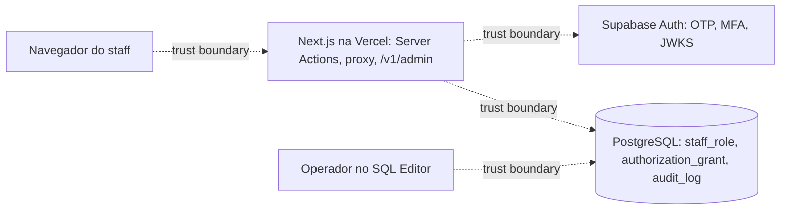

# Threat Model: identity-admin

- **Date**: 2026-09-26
- **Author(s)**: Engenharia
- **Status**: Reviewed
- **Scope**: W2 — login do staff (código por e-mail + TOTP), sessão, guard, `staff_role`, `authorization_grant`,
  `POST /v1/admin/authorization-grants`, telas `/entrar`, `/entrar/mfa`, `/admin`, leituras sob RLS
- **Linked spec**: `docs/specs/identity.md`, `docs/specs/admin.md`
- **Linked ADR(s)**: ADR-0006, ADR-0007, ADR-0008

## 1. Overview

O staff da Luxtory entra pelo Supabase Auth (código de uso único por e-mail) e confirma com um aplicativo TOTP
(AAL2). O servidor verifica o JWT (ES256, JWKS) e o guard decide cada command lendo papéis e grants no PostgreSQL.
Dados: e-mail do staff (no `auth.users` do Supabase), ids de usuário e de party, papéis, grants e auditoria. Nenhum
dado pessoal nas tabelas da aplicação nem nos logs.

## 2. Assets

- Sessão do staff (cookies de access/refresh token) e o segundo fator.
- Autoridade administrativa: papéis `admin`/`super_admin` e grants de parceiros (REQ-014).
- Integridade da auditoria (`operation`, `audit_log`).
- E-mail do staff (PII interna).
- Disponibilidade do login (limite de e-mail do Supabase).

## 3. Actors

| Actor | Trust level | Notes |
|---|---|---|
| Visitante anônimo | untrusted | alcança `/entrar` e o `POST` (sem sessão → 401) |
| Usuário autenticado sem papel | low | só vê a tela 403 do Admin |
| Staff AAL1 | low | só alcança o cadastro/desafio TOTP |
| Staff AAL2 (Admin/Super Admin) | medium | commands do seu papel, sempre pelo guard |
| Operador do runbook (dono das tabelas) | high | atribui/revoga papéis e revoga grants no SQL Editor |
| Site de terceiros | hostile | tenta CSRF contra o `POST` e as Server Actions |

## 4. Data flow diagram

## 5. STRIDE analysis

| Component | S | T | R | I | D | E | Notes |
|---|---|---|---|---|---|---|---|
| Login `/entrar` | T-001 | — | T-006 | T-004 | T-007 | — | código de uso único; resposta não enumera contas |
| MFA `/entrar/mfa` | T-002 | — | T-006 | — | — | T-002 | AAL2 exigido para qualquer autoridade de staff |
| Sessão (cookies, proxy) | T-003 | T-003 | — | T-004 | — | — | `getClaims()` verifica ES256; cookies `httpOnly` |
| Guard + `staff_role` | — | — | T-006 | — | — | T-005 | nega por padrão; papel relido a cada command |
| `POST /v1/admin/authorization-grants` | — | T-008 | T-006 | — | — | T-005, T-008 | origem, idempotência, auditoria |
| `authorization_grant` (tabela) | — | T-009 | T-006 | T-010 | — | T-009 | sem FK até a W7 (D-W2-1), fechado para falhas |
| Leitura sob RLS | — | — | — | T-010 | — | T-011 | `SET LOCAL ROLE authenticated` + claims verificadas |
| Autenticação de teste | T-012 | — | — | — | — | T-012 | só local/CI |

## 6. Threats (prioritized)

### T-005 [HIGH] Elevation — Acesso administrativo sem papel ou sem MFA

- **Vector**: usuário autenticado (ou staff em AAL1) chama o `POST` ou abre o Admin.
- **Likelihood**: Medium · **Impact**: Critical · **Risk**: High
- **Mitigation**:
  - Code: guard exige AAL2 + papel ativo aceito pela autoridade, lido do banco a cada command; layout do Admin relê
    papéis a cada request; sem hierarquia presumida (D-W2-2).
  - Process: papéis só pelas funções do dono, com base registrada e auditoria.
- **Owner**: Engenharia · **Tracking**: testes `[TECH-050]`, `[REQ-014]`

### T-008 [HIGH] Tampering/Elevation — CSRF contra a API e as Server Actions

- **Vector**: página de terceiros envia `POST` com os cookies do staff.
- **Likelihood**: Medium · **Impact**: High · **Risk**: High
- **Mitigation**:
  - Code: `POST /v1/*` exige `Origin` igual ao host (403); Server Actions comparam `Origin` e `Host` (Next); cookies
    `SameSite=Lax`; `Idempotency-Key` obrigatório.
  - Nota (revisão 2026-09-26): a checagem usa `X-Forwarded-Host` (senão `Host`), como o Next faz nas Server Actions.
    Numa página de terceiros, o navegador não deixa forjar esse header: header customizado (`X-Forwarded-Host`,
    `Idempotency-Key`) exige preflight CORS, que a rota não autoriza, e `<form>` não envia header customizado. Um
    cliente fora do navegador pode forjá-lo, mas não carrega os cookies da vítima — não é CSRF. A defesa não depende
    de o edge da Vercel reescrever `X-Forwarded-Host` (comportamento não verificado nesta wave).
- **Owner**: Engenharia · **Tracking**: teste `[TECH-100]`

### T-003 [HIGH] Spoofing — Cookie de sessão forjado ou adulterado

- **Vector**: cookie com JWT falso, expirado ou de outro projeto.
- **Likelihood**: Medium · **Impact**: High · **Risk**: High
- **Mitigation**:
  - Code: identidade só de `getClaims()` (assinatura ES256 pelo JWKS, expiração); nunca de `getSession()`; teste de
    JWT adulterado no adapter de teste.
- **Owner**: Engenharia

### T-009 [MEDIUM] Tampering — Grant para party inexistente antes da W7

- **Vector**: grant criado com `grantee_party_id` arbitrário enquanto não há FK (D-W2-1).
- **Likelihood**: Low · **Impact**: Medium · **Risk**: Medium
- **Mitigation**:
  - Code: validação só aceita operações concedíveis (nenhuma na W2); gatilho no banco recusa grant sem `app.party`
    correspondente (sempre, enquanto a tabela não existir).
  - Process: a W7 cria a FK validada e remove o gatilho (plano → Wave 7).
- **Owner**: Engenharia · **Tracking**: teste `[REQ-014]` (banco recusa)

### T-001 [MEDIUM] Spoofing — Adivinhação do código de login

- **Vector**: força bruta do código de 6 dígitos.
- **Likelihood**: Low · **Impact**: High · **Risk**: Medium
- **Mitigation**: limites e expiração do próprio Supabase Auth; o segundo fator TOTP continua exigido.

### T-002 [MEDIUM] Elevation — Contornar ou sequestrar o cadastro do TOTP

- **Vector**: sessão AAL1 roubada cadastra um fator próprio.
- **Likelihood**: Low · **Impact**: High · **Risk**: Medium
- **Mitigation**: o cadastro exige a sessão do próprio usuário (código de e-mail recente); fatores não verificados são
  removidos antes de novo cadastro; remoção de fator verificado não tem tela (suporte pelo painel do Supabase).
  Cadastro guiado (2026-09-27): a chave manual fica oculta até ser pedida (reduz exposição na tela), "Copiar chave" usa
  só a área de transferência local e os links apontam só para páginas oficiais — nenhum serviço de terceiros recebe
  a chave. Chave exposta antes da verificação: gerar novo QR Code descarta o fator não verificado.
- **Residual**: aceito até existir um fluxo de recuperação definido pela Luxtory.

### T-006 [MEDIUM] Repudiation — Ação administrativa sem rastro

- **Mitigation**: todo command e toda função de operação gravam `operation` + `audit_log` (ator, papel exercido, base,
  antes/depois); leituras administrativas gravam `admin_read` (TECH-092).

### T-010 [MEDIUM] Information disclosure — Leitura de papéis/grants ou de dados de outro usuário

- **Mitigation**: `anon` e `authenticated` sem USAGE em `app` nem grants nessas tabelas; RLS ligada com política só
  para `luxtory_app`; leituras de usuário sob `SET LOCAL ROLE authenticated` com claims verificadas.

### T-004 [LOW] Information disclosure — Enumeração de contas e PII em logs

- **Mitigation**: mesma resposta para e-mail existente ou não; logs sem e-mail, código, token ou id de fator.

### T-011 [LOW] Elevation — Claims ou papel vazando entre transações

- **Mitigation**: `SET LOCAL` e `set_config(..., true)` só valem na transação (Supavisor em modo transação); teste
  prova a volta ao papel `luxtory_app` sem claims.

### T-007 [LOW] Denial of service — Esgotar o limite de e-mail do Supabase

- **Mitigation**: SMTP padrão só envia para membros da organização (P-9); resposta "muitas tentativas"; D4 (SMTP
  próprio) antes do login de Titulares. **Atualização 2026-09-27**: D4 resolvida — SMTP customizado com Resend; o
  limite de envio passa a ser o do SMTP customizado no Supabase Auth, e a credencial fica só no Supabase.

### T-012 [LOW] Spoofing — Autenticação de teste ativa num deployment

- **Mitigation**: `AUTH_MODE=test` recusado quando `VERCEL_ENV` existe (validação de ambiente falha); chave do JWT de
  teste aleatória por processo; Auth real recusado fora de Production (D-W2-3).

## 7. Abuse cases

- Staff Admin tentando agir como Super Admin (ou o inverso) → o guard só aceita o papel exercido que a autoridade
  permite e que está ativo.
- Parceiro com grant de um Concept tentando agir em outro → escopo diferente, negado.
- Grant revogado ou vencido reutilizado → negado no command seguinte.
- Repetição de `POST` com a mesma chave e outro corpo → `ERR_IDEMPOTENCY_CONFLICT`.

## 8. Residual risk

- Login e MFA reais só são provados em Production depois do merge (ADR-0007, sem staging) — aceito pela Luxtory em
  2026-09-26 (reavaliação da D3 na W2).
- Sessão válida até o JWT expirar para navegação sem command — mitigado pela releitura de papéis no layout.

## 9. References

- OWASP ASVS V2 (autenticação), V3 (sessão), V4 (controle de acesso).
- `03`: TECH-050, TECH-051, TECH-052, TECH-092, TECH-100, ADR-002.
