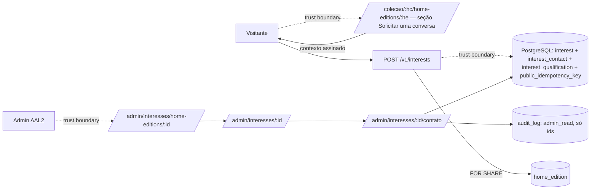

# Threat Model: ownership — Interesse (W5)

- **Date**: 2026-10-19
- **Author(s)**: Engenharia (W5)
- **Status**: Reviewed (W5)
- **Scope**: `POST /v1/interests` (escrita pública sem conta), `app.interest`, `app.public_idempotency_key` e a visão
  `/admin/interesses`
- **Linked spec**: [`docs/specs/ownership.md`](../../specs/ownership.md)
- **Linked ADR(s)**: [ADR-0017](../../adr/0017-idempotencia-de-mutacoes-publicas-nao-criticas.md),
  [ADR-0014](../../adr/0014-discovery-publico-leitura-anonima-csp-e-publicacao.md),
  [ADR-0010](../../adr/0010-catalogo-versoes-e-mutacoes-do-admin.md) §7, ADR-0004 (Upstash)

## 1. Overview

A W5 abre a primeira escrita pública **persistida** sem conta: o visitante registra uma manifestação de interesse num
Home Concept publicado (campos canônicos do `03` §3.1). Não há dado de contato (W6, `P-3`), mas há campos de texto livre
(`region`, `origin`, `partner_ref`) que podem receber texto pessoal digitado. A escrita passa por portão, origem,
limites de corpo, rate limit distribuído (Upstash, reutilizado da BP1) e idempotência atômica no PostgreSQL. A leitura
é só do staff Admin, auditada.

## 2. Assets

- Integridade do registro de interesse e das invariantes "interesse nunca gera direito" (REQ-025) e "sem
  prerrogativa" (REQ-023).
- Disponibilidade do banco e da aplicação diante de escrita anônima (custo do Supabase Free, D2).
- Texto livre do visitante (possível PII digitada) — fora de logs, erros e respostas.
- Segredo da pseudonimização da origem de rede (`BRAND_PARTNERS_CONTACT_HMAC_SECRET`) e credenciais Upstash.
- Confidencialidade da existência de Home Concepts não publicados (BR-015) e da demanda agregada (só staff).

## 3. Actors

| Actor | Trust level | Notes |
|---|---|---|
| Visitante anônimo | untrusted | alcança só `POST /v1/interests`; todo campo é não confiável |
| Bot / atacante externo | hostile | volume, enumeração, injeção, replay de chaves |
| Admin (AAL2, papel exercido) | medium | lê a visão agrupada; cada leitura grava `admin_read` |
| Vercel (plataforma) | high | escreve `x-real-ip`; fonte única da origem de rede |
| Upstash Redis | medium | só contadores com expiração; nunca decide estado |

## 4. Data flow diagram

```mermaid
flowchart LR
  visitor[Visitante] -.trust boundary.-> route[POST /v1/interests]
  route -.trust boundary.-> redis[(Upstash: contadores)]
  route --> catalog[catalog: leitura pública como anon]
  route -.trust boundary.-> db[(PostgreSQL: interest + public_idempotency_key)]
  admin[Admin AAL2] -.trust boundary.-> page[/admin/interesses]
  page --> db
```

## 5. STRIDE analysis

| Component | S | T | R | I | D | E | Notes |
|---|---|---|---|---|---|---|---|
| `POST /v1/interests` | ✓ | ✓ | ✓ | ✓ | ✓ | ✓ | anônimo por definição (S aceito); origem do mesmo host contra CSRF |
| Rate limit (Upstash) | ✓ | — | — | ✓ | ✓ | — | identidade de rede só da plataforma; pseudônimo HMAC com separação de domínio |
| `app.interest` | — | ✓ | ✓ | ✓ | ✓ | ✓ | constraints, gatilhos, só inserção, RLS só `luxtory_app` |
| `app.public_idempotency_key` | — | ✓ | — | ✓ | ✓ | — | só hash; chave UUID; só inserção |
| `/admin/interesses` | ✓ | — | ✓ | ✓ | — | ✓ | guard AAL2 + papel Admin; `admin_read` |

## 6. Threats (prioritized)

### T-401 [MEDIUM] Denial of service — inundação de registros anônimos

- **Vector**: bot envia manifestações em volume para encher o banco (plano Free) ou degradar a aplicação.
- **Likelihood**: Medium · **Impact**: Medium · **Risk**: Medium
- **Mitigation**:
  - Code: limite por origem de rede (IPv6 reduzido ao /64) e global, contando também as tentativas recusadas depois;
    limitador antes de qualquer acesso ao banco; falha fechada (`503`) sem Redis, com timeout próprio; corpo limitado a
    8 KiB pelos bytes recebidos; recusas não gravam nada (ADR-0017).
  - Config: limites e prazos sem default (TECH-001), definidos pela operação; portão `INTEREST_WRITES` fechado em
    Production até a ativação; proteção de borda da Vercel.
  - Process: D2 (Supabase Pro) antes da coleta produtiva.
- **Owner**: Engenharia · **Tracking**: W5

### T-402 [MEDIUM] Tampering / Elevation — interesse usado como direito ou prerrogativa

- **Vector**: cliente envia `approx_days`, `origin` ou `partner_ref` para obter prioridade, atribuição comercial ou
  vínculo (REQ-023, REQ-025).
- **Likelihood**: Medium · **Impact**: High · **Risk**: Medium
- **Mitigation**:
  - Code: nenhuma tabela de direitos, calendário, inventário, booking, Créditos ou economia referencia `interest`; o
    registro altera só `interest` e a chave pública (teste `[REQ-023]`/`[REQ-025]` por diferença de tabelas);
    `origin`/`partner_ref` sem FK, sem enum, fora de qualquer regra, ordenação ou agrupamento; `approx_days` só para
    `co_owner` (CHECK + schema).
  - Process: BP2/W8 não podem usar esses campos como fonte (spec `ownership` §5.1).
- **Owner**: Engenharia · **Tracking**: W5

### T-403 [MEDIUM] Information disclosure — texto pessoal em logs e erros

- **Vector**: visitante digita nome/telefone em `region`, `origin` ou `partner_ref`; o valor vaza por log, erro ou
  resposta.
- **Likelihood**: Medium · **Impact**: Medium · **Risk**: Medium
- **Mitigation**:
  - Code: log só com `stage`, `status`, `duration_ms` e código de motivo; `ERR_VALIDATION` só com nome e código do
    campo; resposta `201` sem eco nem id; teste de log sem valores; `no-store`.
  - Config: leitura restrita ao Admin AAL2; a visão agrupada não mostra registros individuais nem `origin`/`partner_ref`.
- **Owner**: Engenharia · **Tracking**: W5

### T-404 [LOW] Information disclosure — enumeração de Home Concepts não publicados

- **Vector**: atacante varia `home_edition_id` para descobrir Home Editions em preparação ou fora do público (BR-015, BR-036).
- **Likelihood**: Low · **Impact**: Medium · **Risk**: Low
- **Mitigation**:
  - Code: alvo resolvido pela leitura pública como `anon` sob RLS (ADR-0014); inexistente, não publicado e de outro
    Home Concept respondem o mesmo `404`; ids são UUID; rate limit.
- **Owner**: Engenharia · **Tracking**: W5

### T-405 [LOW] Tampering — reuso ou colisão de `Idempotency-Key`

- **Vector**: sem ator, o escopo é a superfície; uma chave previsível de um visitante colidiria com a de outro, ou um
  atacante reusaria a chave alheia.
- **Likelihood**: Low · **Impact**: Low · **Risk**: Low
- **Mitigation**:
  - Code: chave UUID obrigatória (imprevisível, gerada pelo cliente); replay só com o mesmo conteúdo validado (devolve
    apenas `{status: registered}`, sem dado); conteúdo diferente → `409`; reserva atômica no índice único.
- **Owner**: Engenharia · **Tracking**: W5

### T-406 [LOW] Spoofing — CSRF e origem de rede forjada

- **Vector**: página de terceiro submete em nome do visitante; cliente forja `x-forwarded-for` para fugir do limite.
- **Likelihood**: Low · **Impact**: Low · **Risk**: Low
- **Mitigation**:
  - Code: `Origin` do mesmo host (`isSameOrigin`); sem CORS; origem de rede só do `x-real-ip` escrito pela Vercel
    (ausente/malformado → `503`); fora da Vercel, origem única `local`.
- **Owner**: Engenharia · **Tracking**: W5

### T-407 [LOW] Information disclosure — linkagem entre superfícies pelo pseudônimo de rede

- **Vector**: reutilizar o mesmo segredo HMAC da BP1 faria o mesmo IP gerar o mesmo pseudônimo no contato Brand Partners
  e no interesse, permitindo correlacionar as jornadas pelas chaves do Redis.
- **Likelihood**: Low · **Impact**: Low · **Risk**: Low
- **Mitigation**:
  - Code: separação de domínio — o pseudônimo do interesse é HMAC de `interest` + origem de rede
    (`pseudonymizeNetwork(…, 'interest')`), diferente do pseudônimo da BP1 para o mesmo IP; namespaces distintos no
    Redis; chaves com expiração. **Conclusão**: não há necessidade demonstrada de segredo novo — o segredo existente,
    com separação de domínio, atende (decisão do fundador de 2026-10-19).
- **Owner**: Engenharia · **Tracking**: W5

### T-408 [LOW] Repudiation — escrita anônima sem `audit_log`

- **Vector**: sem ator, não há quem auditar; disputa sobre "quem registrou".
- **Likelihood**: Low · **Impact**: Low · **Risk**: Low
- **Mitigation**: registro imutável com `created_at` do `Clock`; logs com `correlation_id`; a leitura do Admin grava
  `admin_read` (TECH-092). Interesse não é mutação crítica (TECH-002), por isso fica fora do `audit_log` de command.

## 7. Abuse cases

- Bot repete o mesmo corpo com chaves novas → contado pelo limitador; cada registro é uma manifestação (sem direito).
- Visitante tenta `approx_days` para Owner ou `0`/negativo → `400`; banco recusa por CHECK em qualquer caminho.
- Cliente envia `home_edition_id` em preparação, fora do público ou inexistente → `404`, sem distinguir o motivo (a F2a saiu na W4.2).
- Atacante injeta HTML/script em `region` → texto simples, controles recusados; React escapa na visão do Admin.
- Upstash fora do ar → `503` antes do banco; nenhuma escrita sem limitador.

## 8. Residual risk

- Retenção sem expurgo das chaves de idempotência públicas e dos interesses (sem PII de contato) — follow-up de
  operação; aceito na W5 (Engenharia).
- Rate limit da aplicação continua ausente nas rotas do Admin e no login (superfície só de staff AAL2 e Supabase Auth
  com limites próprios). A W5 aplica o limitador só à escrita pública de interesse, conforme o plano; reavaliar na W7
  (login de Titulares) e na W30.
- Campos livres podem conter texto pessoal digitado: armazenados, nunca logados; a W6 (`P-3`) define base LGPD e aviso.

## 9. References

- OWASP Top 10 — https://owasp.org/Top10/
- OWASP ASVS — https://owasp.org/asvs/
- Microsoft STRIDE — https://learn.microsoft.com/en-us/azure/security/develop/threat-modeling-tool
- `03`: TECH-056, TECH-092, TECH-100, ADR-006; `02`: REQ-022–REQ-025; `01`: BR-015, BR-040–BR-043, BR-060.

## W4.2 — Interesse a partir da Home Edition (2026-10-19)

- **Scope**: `home_edition_id` obrigatório, sem `concept_id`; `region` → `desired_location`; sai a F2a. Superfície
  pública inalterada (mesmo endpoint, portão, limitador e idempotência); escrita segue fechada em Production.
- **Linked spec / ADR**: `docs/specs/ownership.md` §13 · ADR-0019

| Ameaça | Mudança |
|---|---|
| T-404 Enumeração | O alvo passa a ser a Home Edition: em preparação, fora do público, de Home Concept não público ou inexistente respondem o mesmo `404`. |
| T-403 Texto pessoal | `desired_location` herda as regras de `region`: nunca em logs, erros, métricas ou respostas. |
| T-402 Interesse como direito | Inalterado: `home_edition_id` não cria vínculo com Second Home, Ação ou Direito de Uso. |
| Abuso F2a | Sai: a Home Edition não tem modalidade (BR-032); qualquer modalidade desejada é aceita. |

Nenhuma ameaça nova: sem campo novo de visitante, sem contato e sem dado pessoal (W6).

## W6 — Solicitação de conversa na Home Edition (2026-10-20)

- **Scope**: formulário na página pública da Home Edition; `interest_contact` (nome, telefone, e-mail) e
  `interest_qualification` (dimensão de investimento, unidade de decisão, horizonte); hash de idempotência chaveado;
  contexto de apresentação assinado; revalidação da Home Edition dentro da transação; drill-down do Admin até o contato
  e a pré-qualificação; Aviso de Privacidade da jornada. Primeira PII de cliente persistida pela aplicação. A coleta
  continua fechada em Production até os gates de go-live.
- **Linked spec / ADR**: `docs/specs/ownership.md` §14 · [ADR-0018](../../adr/0018-contato-e-pre-qualificacao-do-interesse.md)
  · inventário [`lgpd-interesse.md`](../lgpd-interesse.md)

**Assets acrescentados:** confidencialidade e eliminabilidade do contato e da pré-qualificação;
`INTEREST_REQUEST_HMAC_SECRET` (hash da idempotência) e `INTEREST_CONTEXT_HMAC_SECRET` (contexto de apresentação);
autenticidade do vínculo com a média projetada apresentada; integridade dos portões da coleta; dados digitados no
navegador.

**Actors acrescentados:** terceiro cujo contato é enviado por outra pessoa (titular dos dados, sem interação);
navegador do visitante (guarda o formulário em memória e devolve o contexto assinado).



| Component | S | T | R | I | D | E | Notes |
|---|---|---|---|---|---|---|---|
| Formulário na Home Edition | ✓ | ✓ | — | ✓ | — | — | dados só em memória; contexto assinado no servidor |
| `app.interest_contact` / `app.interest_qualification` | — | ✓ | ✓ | ✓ | — | ✓ | RLS só `luxtory_app` (SELECT/INSERT); UPDATE/TRUNCATE recusados; DELETE sem grant |
| Hash da idempotência | — | ✓ | — | ✓ | — | — | HMAC com segredo próprio; esquema/chave por registro |
| Contexto de apresentação | ✓ | ✓ | — | — | — | — | HMAC próprio; sem PII; Home Edition conferida |
| Revalidação na transação | — | ✓ | — | — | ✓ | — | `FOR SHARE` na linha da Home Edition; espera curta da retirada concorrente |
| Portões da coleta | — | ✓ | — | — | — | ✓ | quatro condições simultâneas; Aviso `approved` só por commit |
| Drill-down do Admin | ✓ | — | ✓ | ✓ | — | ✓ | PII só no nível "contato e pré-qualificação"; `admin_read` por leitura |

### T-409 [HIGH] Information disclosure — exposição do contato e da pré-qualificação

- **Vector**: leitura do contato ou da pré-qualificação por quem não deveria (papel errado, PostgREST, log, erro,
  exportação, tela de lista).
- **Likelihood**: Medium · **Impact**: High · **Risk**: High
- **Mitigation**:
  - Code: tabelas próprias com RLS só para `luxtory_app`, Data API desligada (ADR-0006); Admin AAL2 com papel exercido
    (Super Admin sozinho não acessa); PII só em `/admin/interesses/[id]/contato`, com `admin_read` de contato e de
    pré-qualificação (só ids); grupo e interesse individual sem PII; sem busca, filtro, exportação nem e-mail; logs e
    respostas nunca com contato, pré-qualificação ou contexto; erros do banco registrados só pelo nome do erro.
  - Test: sentinelas de PII ausentes dos logs da rota e do `audit_log`; `anon`/`authenticated` sem leitura; portão do
    Admin.
- **Owner**: Engenharia · **Tracking**: W6

### T-410 [MEDIUM] Spoofing — contato de terceiro enviado por outra pessoa

- **Vector**: alguém envia nome, telefone e e-mail de outra pessoa; a Luxtory contata quem não pediu.
- **Likelihood**: Medium · **Impact**: Medium · **Risk**: Medium
- **Mitigation**:
  - Code: a W6 não envia mensagem automática a ninguém — o formulário não dispara e-mail, SMS ou WhatsApp.
  - Process: o primeiro contato é humano (BR-064); pedidos do titular entram pelo procedimento de direitos, gate de
    go-live. Residual aceito até lá.
- **Owner**: Luxtory (operação) · **Tracking**: go-live W6

### T-411 [MEDIUM] Information disclosure — derivado de PII no registro imutável de idempotência

- **Vector**: com o conteúdo incluindo contato e pré-qualificação, um SHA-256 sem chave permitiria confirmar um
  conteúdo adivinhado e sobreviveria à eliminação.
- **Likelihood**: Low · **Impact**: Medium · **Risk**: Medium
- **Mitigation**:
  - Code: HMAC-SHA-256 com `INTEREST_REQUEST_HMAC_SECRET` (segredo próprio); `hash_scheme`/`hash_key_id` por registro;
    nenhuma chave, segredo ou claro no banco; chave desconhecida → `503`.
  - Process: o HMAC é pseudonimização; o derivado consta do inventário para a validação jurídica; rotação não é
    eliminação.
- **Owner**: Engenharia · **Tracking**: W6

### T-412 [MEDIUM] Elevation — abertura indevida da coleta

- **Vector**: `INTEREST_WRITES=open` configurado por engano antes do Aviso, do jurídico ou da D2.
- **Likelihood**: Low · **Impact**: High · **Risk**: Medium
- **Mitigation**:
  - Code: em Production, endpoint e seção do formulário exigem site aberto + `INTEREST_WRITES=open` + Aviso `approved`
    (só por commit revisado) + configuração completa; nenhuma condição sozinha abre.
  - Test: Production com `INTEREST_WRITES=open` e Aviso `pending` → `404` e sem seção; Aviso `approved` com escrita
    fechada → `404`.
- **Owner**: Engenharia · **Tracking**: W6

### T-413 [MEDIUM] Tampering — contexto de apresentação forjado ou reaproveitado

- **Vector**: o cliente envia um id de média projetada que a página não mostrou (outra Home Edition, valor menor ou
  maior) para distorcer a pré-qualificação, ou troca a variante da pergunta.
- **Likelihood**: Medium · **Impact**: Low · **Risk**: Medium
- **Mitigation**:
  - Code: contexto `{v, k, h, p}` assinado no servidor com `INTEREST_CONTEXT_HMAC_SECRET`, comparação em tempo
    constante; `h` precisa ser a Home Edition do corpo; variante derivada no servidor (modalidade + `p`); gatilho no
    banco confere que a referência é da mesma Home Edition e que a variante bate com a modalidade.
  - Residual: reenviar um contexto antigo autêntico só registra uma referência que a página de fato apresentou naquela
    Home Edition; a pré-qualificação é declaração do interessado, nunca decisão.
- **Owner**: Engenharia · **Tracking**: W6

### T-414 [LOW] Information disclosure — dados no navegador

- **Vector**: dados do formulário persistidos no dispositivo (storage, cache, URL).
- **Mitigation**: dados só no estado do componente; nada em `localStorage`/`sessionStorage`/URL; respostas
  `no-store`; sucesso limpa os campos; o contexto assinado não tem PII.
- **Owner**: Engenharia · **Tracking**: W6

### T-415 [MEDIUM] Repudiation — eliminação sem trilha

- **Vector**: `DELETE` manual do contato ou da pré-qualificação no console, sem fundamento nem auditoria.
- **Mitigation**: o papel de aplicação não tem `DELETE`; não há ação de eliminação na W6; o go-live exige procedimento
  operacional (quem executa, fundamento, verificação de identidade, auditoria, backups, conservação legal); `DELETE`
  manual não auditado em Production não é solução; o `down` das migrations recusa apagar linhas existentes.
- **Owner**: Luxtory + Engenharia · **Tracking**: go-live W6

### T-416 [LOW] Denial of service — corpo maior e trava de leitura

- **Vector**: o limite passa de 8 para 16 KiB; a trava `FOR SHARE` poderia segurar a retirada da Home Edition.
- **Mitigation**: limite contado pelos bytes recebidos, antes do parse, e justificado pelo pior caso escapado;
  limitador antes do banco; a trava dura só a transação curta do registro (sem I/O externo) e não conflita com as
  travas de chave das FKs.
- **Owner**: Engenharia · **Tracking**: W6

### T-417 [MEDIUM] Tampering / Elevation — pré-qualificação usada como prioridade ou valor

- **Vector**: as respostas viram score, ordem ou faixa de valor; a média projetada vira preço individual de Owner ou de
  Ação (BR-034, REQ-101).
- **Likelihood**: Low · **Impact**: Medium · **Risk**: Medium
- **Mitigation**:
  - Code: códigos fechados sem número; nenhum valor gravado ou derivado; nenhuma regra, ordenação ou agrupamento do
    software usa a pré-qualificação; o Admin só a mostra no nível individual.
  - Test: o registro altera só as três tabelas do interesse e a chave pública; textos sem promessa de retorno.
- **Owner**: Engenharia · **Tracking**: W6

**Abuse cases (W6):** bot envia contatos falsos em volume → limitador (T-401); cada contato pode ser eliminado pelo
procedimento futuro, a manifestação imutável permanece · mesma chave com outro e-mail ou outra resposta → `409` ·
replay depois da eliminação → `201` sem recriar · contexto de outra Home Edition → `400` · retirada da Home Edition
durante o envio → `404` sem nada gravado · URL do Admin com localização pretendida → não existe (grupo pelo id da Home
Edition).

**Residual risk (W6):** derivado chaveado no registro imutável enquanto a chave existir (T-411); contatos de terceiros
até o procedimento de direitos (T-410); retenção sem expurgo automático até o procedimento de go-live; contexto
autêntico reaproveitado (T-413, sem efeito econômico).
