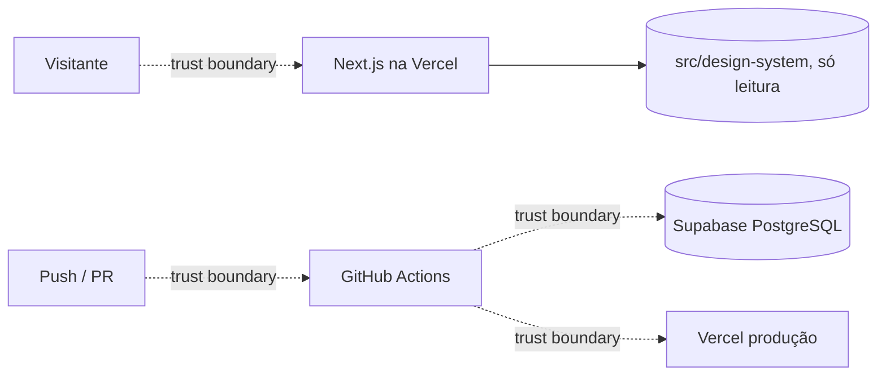

# Threat Model: platform (W0 — fundação)

- **Date**: 2026-09-25
- **Author(s)**: Engenharia
- **Status**: Accepted
- **Scope**: `GET /v1/health`, `GET /v1/version`, rota interna `/lab`, logs, pipeline CI/CD e cadeia de dependências
- **Linked spec**: `docs/specs/platform.md`
- **Linked ADR(s)**: ADR-0003, ADR-0004, ADR-0005, ADR-0006

## 1. Overview

A W0 publica dois probes públicos sem dados, uma rota interna que serve arquivos estáticos do Design System fora de
produção e o pipeline que leva código a produção. Não há autenticação, banco em uso pelo app nem dado pessoal.
O maior valor a proteger nesta fase é o **caminho até produção** (segredos da CI e integridade do deploy).

## 2. Assets

- Secrets da CI: `VERCEL_TOKEN`, `DATABASE_URL_MIGRATIONS` (credencial do dono do schema no Supabase).
- Integridade do deployment de produção e do schema do banco.
- Arquivos do repositório fora do Design System (código, configuração).
- Disponibilidade dos probes.

## 3. Actors

| Actor                     | Trust level | Notes                                              |
|---------------------------|-------------|----------------------------------------------------|
| Anonymous user            | untrusted   | acessa `/v1/health`, `/v1/version`                 |
| Colaborador com push      | medium      | GitHub Free não protege `main`                     |
| Contribuidor via fork/PR  | low         | PRs não recebem secrets                            |
| GitHub Actions / Vercel   | high        | executam build e deploy                            |
| Attacker (external)       | hostile     |                                                    |

## 4. Data flow diagram

## 5. STRIDE analysis

| Component | S | T | R | I | D | E | Notes |
|-----------|---|---|---|---|---|---|-------|
| `/v1/health`, `/v1/version` | — | — | — | T-001 | T-005 | — | sem entrada além do header de correlação |
| `/lab` | — | — | — | T-002, T-003 | T-005 | — | só GET de arquivos estáticos |
| Logs | T-004 | T-004 | — | T-004 | — | — | JSON com `correlation_id` |
| Pipeline CI/CD | T-006 | T-006 | — | T-007 | — | T-006 | segredos e deploy |
| Dependências | — | T-008 | — | — | — | T-008 | npm e actions |

Repúdio não se aplica à W0: não há mutation. A trilha de auditoria chega na W1 (TECH-092).

## 6. Threats (prioritized)

### T-006 [HIGH] Tampering/Elevation — deploy ou migração não autorizados em produção

- **Vector**: push direto em `main` (sem branch protection no GitHub Free) ou deploy automático da integração Git
  publicando código que não passou pelos gates; migração aplicada fora de ordem.
- **Likelihood**: Medium · **Impact**: High · **Risk**: High
- **Mitigation**:
  - Config: `vercel.json` desliga o deploy Git de `main`; produção só pelo job `deploy`, que depende de `migrate`,
    que depende de todos os gates. `dbmate --strict` recusa migração fora de ordem.
  - Process: toda mudança entra por PR (`CLAUDE.md`); `concurrency: production` impede dois deploys simultâneos.
  - Residual: quem tem push em `main` ainda dispara a CI de produção — aceito até haver plano pago do GitHub.
- **Owner**: Engenharia · **Tracking**: W0

### T-007 [HIGH] Information disclosure — vazamento de segredos da CI

- **Vector**: secret impresso em log, exposto a PR de fork ou versionado por engano.
- **Likelihood**: Low · **Impact**: High · **Risk**: Medium
- **Mitigation**:
  - Config: secrets só nos jobs `migrate` e `deploy`, que rodam apenas em push para `main` (PRs não os recebem);
    `permissions: contents: read`.
  - Code: `scripts/lib/dbmate.mjs` passa a URL por variável de ambiente (fora de `argv`) e mascara credenciais em
    mensagens de erro; `loadEnv` nunca inclui valores em erros.
  - Infra: gitleaks em toda execução, com o histórico completo.
- **Owner**: Engenharia · **Tracking**: W0

### T-003 [MEDIUM] Information disclosure — path traversal em `/lab`

- **Vector**: `/lab/../../.env.local` ou variações codificadas para ler arquivos fora do Design System.
- **Likelihood**: Medium · **Impact**: High · **Risk**: Medium
- **Mitigation**:
  - Code: lista fechada de pastas (`lab`, `styles`, `tokens`, `fonts`, `brand`, `icons`) e extensões; segmentos
    validados (sem `.` inicial nem `..`); caminho resolvido verificado sob a raiz; testes com os vetores.
  - Config: 404 em produção; o bundle de produção só inclui essas pastas (`outputFileTracingIncludes`).
- **Owner**: Engenharia · **Tracking**: `tests/features/platform/presentation/lab.test.ts`

### T-004 [MEDIUM] Spoofing/Tampering/Information disclosure — logs

- **Vector**: `x-correlation-id` forjado para injetar linhas ou confundir a investigação; PII registrada por engano.
- **Likelihood**: Medium · **Impact**: Medium · **Risk**: Medium
- **Mitigation**:
  - Code: id de correlação aceito só com 8–128 caracteres seguros, senão UUID; logs em JSON (sem injeção de
    linha); chaves sensíveis (`cpf`, `email`, `nome`, `token`, …) redigidas mesmo aninhadas; caminho sem query string.
- **Owner**: Engenharia · **Tracking**: `logger.test.ts`, `route.test.ts`

### T-008 [MEDIUM] Tampering — cadeia de dependências

- **Vector**: pacote npm ou action comprometidos.
- **Likelihood**: Low · **Impact**: High · **Risk**: Medium
- **Mitigation**:
  - Config: versões exatas e lockfile; `npm ci`; `npm audit --omit=dev --audit-level=high`; Semgrep CE; actions
    fixadas por SHA completo; Dependabot com `cooldown` de 7 dias; `.npmrc` `min-release-age=7` (npm ≥ 11.10).
- **Owner**: Engenharia · **Tracking**: ADR-0004

### T-002 [LOW] Information disclosure — Lab indexado ou exposto em produção

- **Mitigation**: 404 com `VERCEL_ENV=production`; `X-Robots-Tag: noindex, nofollow` e `<meta name="robots">`;
  previews sob Deployment Protection da Vercel. O conteúdo do Lab não é sigiloso.

### T-001 [LOW] Information disclosure — `/v1/version` revela o commit

- **Mitigation**: aceito. O sha não é segredo e é necessário para verificar o deploy (`/deploy`).

### T-005 [LOW] Denial of service — probes e Lab

- **Mitigation**: respostas estáticas e baratas, `cache-control: no-store` só nos probes; proteção de borda da Vercel.
  Rate limit de escrita chega na W5.

## 7. Abuse cases

- Varredura automatizada de caminhos em `/lab` procurando `.env*`, `package.json` ou código-fonte → 404 (T-003).
- PR de fork tentando exfiltrar secrets pela CI → jobs com secrets não rodam em PR (T-007).
- Push direto em `main` para pular a revisão → gates continuam obrigatórios antes de `migrate` e `deploy` (T-006).
- Cabeçalhos de segurança adicionais (`nosniff`, `X-Frame-Options: DENY`, `Referrer-Policy`, `Permissions-Policy`)
  em todas as respostas; CSP entra com a primeira página pública (W4).

---

## W1 — núcleo de commands, jobs e banco da aplicação (2026-09-26)

- **Scope**: pipeline de commands (TECH-054), `GET /api/jobs/{job}` (Vercel Cron), outbox, conexão do app ao Supabase
  como `luxtory_app`, verificador SCRAM, schema `app`.
- **Linked**: `docs/specs/platform.md` → W1; ADR-0006, ADR-0007; runbook `docs/how-to/operacao.md`.

### STRIDE (W1)

| Component | S | T | R | I | D | E | Notes |
|-----------|---|---|---|---|---|---|-------|
| `/api/jobs/{job}` | T-101 | — | — | T-101 | T-105 | — | público na internet, protegido por segredo |
| Executor de commands | — | T-103 | T-102 | — | T-105 | T-103 | nenhum command de negócio exposto na W1 |
| `audit_log` / `operation` | — | T-102 | T-102 | T-104 | — | — | trilha só de inserção |
| Conexão app → Supabase | T-106 | T-106 | — | T-106 | — | T-103 | TLS e credencial do papel de aplicação |
| Outbox / notificações | — | — | — | T-104 | T-105 | — | entrega ao menos uma vez |

### T-106 [HIGH] Spoofing/Information disclosure — credencial ou conexão do banco canônico

- **Vector**: `DATABASE_URL` marcada também para Preview (qualquer branch lê o banco canônico); TLS sem verificação
  (MITM entre Vercel e Supavisor); senha do papel em texto puro no SQL Editor ou nos logs do Supabase.
- **Mitigation**:
  - Code: `getDatabase` recusa conexão com `VERCEL_ENV` diferente de `production` antes de abrir socket (ADR-0007);
    `sslmode` só `verify-full` (CA raiz do Supabase fixada no código, host conferido) ou `disable` (local);
    mensagens de erro nunca incluem a URL.
  - Process: senha definida por verificador SCRAM gerado localmente (`npm run db:password-verifier`); fingerprint da
    CA conferido no runbook.
- **Owner**: Engenharia · **Tracking**: `connection.test.ts`, `app-core.db.test.ts`

### T-102 [HIGH] Repudiation/Tampering — adulteração da trilha de auditoria

- **Vector**: bug ou credencial do app reescrevendo `audit_log` ou o estado de `operation`.
- **Mitigation**:
  - DB: `luxtory_app` só tem `INSERT` em `audit_log`; gatilhos recusam `UPDATE`/`DELETE`/`TRUNCATE` até para o dono;
    `operation` só avança de estado e nunca é apagada; resposta de idempotência gravada uma vez.
  - Code: command sem registro de auditoria não comita (REQ-015). O selo encadeado chega na W30 (TECH-092).
- **Owner**: Engenharia · **Tracking**: `app-core.db.test.ts`, `commands.db.test.ts`

### T-103 [MEDIUM] Elevation/Tampering — privilégio excessivo ou command fora do registro

- **Vector**: handler que escreve estado crítico sem passar pelo pipeline; papel de aplicação com DDL.
- **Mitigation**: registro fechado do TECH-051 (executor recusa handler não registrado); `luxtory_app` sem DDL, sem
  acesso a `dbmate` e só com os `UPDATE` de coluna do núcleo; guard obrigatório por injeção (W2 entrega o real).
- **Owner**: Engenharia · **Tracking**: `registry.test.ts`, `executor.test.ts`, `app-core.db.test.ts`

### T-101 [MEDIUM] Spoofing/Information disclosure — chamada não autorizada de jobs

- **Vector**: terceiro chamando `/api/jobs/outbox` repetidamente, adivinhando o segredo ou enumerando nomes de job.
- **Mitigation**: `Authorization: Bearer <CRON_SECRET>` comparado em tempo constante (hash dos dois lados); segredo
  com ao menos 32 caracteres; autenticação antes de resolver o nome (401 não revela se o job existe); sem segredo
  configurado → 503 (endpoint desligado). Execuções repetidas são idempotentes (TECH-090).
- **Owner**: Engenharia · **Tracking**: `jobs.test.ts`

### T-104 [MEDIUM] Information disclosure — PII em auditoria, eventos ou erros de consumidor

- **Mitigation**: antes/depois e payloads passam pela mesma redação de chaves sensíveis dos logs; `last_error` do
  outbox e logs de consumidor guardam só o nome do erro; snapshots identificam entidades por id.
- **Owner**: Engenharia · **Tracking**: `executor.test.ts`, `commands.db.test.ts`, `outbox.db.test.ts`

### T-105 [LOW] Denial of service — contenção de locks e varreduras

- **Mitigation**: `lock_timeout` local e tentativas limitadas (runbook); varredura com `FOR UPDATE SKIP LOCKED`, um
  evento por transação e lote limitado; rate limit de escrita na W5.

### Abuse cases (W1)

- Replay de uma mutation com a mesma `Idempotency-Key` e outro corpo → `ERR_IDEMPOTENCY_CONFLICT`, sem efeito.
- Dois retries simultâneos do cliente → uma única operação; o segundo recebe a mesma resposta (CONC-12).
- Preview de branch maliciosa tentando ler o banco → sem credencial e conexão recusada pelo código (ADR-0007).
