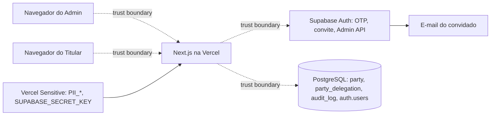

# Threat Model: titular-pii

- **Date**: 2026-10-21
- **Author(s)**: Engenharia
- **Status**: Reviewed
- **Scope**: W7 — `party` (CPF/CNPJ cifrado + HMAC), `party_delegation` (pendente → ativa → revogada), convite e
  ativação pelo Supabase Auth (Admin API), Área do Titular (`/titular*`), telas e API do Admin (`/admin/partes*`,
  `POST /v1/admin/parties*`, `POST /v1/admin/party-delegations/{id}/revoke`), vínculo `investor_authorization → party`,
  FK validada de `authorization_grant` (D-W2-1)
- **Linked spec**: `docs/specs/identity.md` §13, `docs/specs/catalog.md` (D-W3-1)
- **Linked ADR(s)**: ADR-0002, ADR-0006, ADR-0007, ADR-0008, ADR-0020

## 1. Overview

O Admin cadastra a party pelo CPF/CNPJ (normalizado, cifrado com AES-256-GCM + `key_id`, HMAC com anel próprio) e
convida um representante pelo e-mail; o Supabase Auth envia o convite (conta nova, não confirmada) ou o representante
entra com a conta que já tem. A delegação nasce **pendente** e só passa a valer quando o próprio usuário, autenticado,
a ativa. A Área do Titular lê sob RLS (`authenticated` + claims verificadas) e mostra o documento só mascarado. Dados:
CPF/CNPJ (PII de cliente; CNPJ é público, CPF não), e-mail do representante (só em `auth.users`), ids e auditoria.

## 2. Assets

- CPF/CNPJ em claro e seus derivados (HMAC, máscara).
- Chaves de cifra e segredo do HMAC (anéis `PII_*`), `SUPABASE_SECRET_KEY`.
- Vínculo de representação (`party_delegation`): quem age pela party.
- E-mails em `auth.users`.
- Integridade da auditoria (`operation`, `audit_log`) e do vínculo do Investor.

## 3. Actors

| Actor | Trust level | Notes |
|---|---|---|
| Visitante anônimo | untrusted | alcança `/titular/entrar` e `/titular/ativar` |
| Usuário autenticado sem delegação | low | vê só "Acesso negado" |
| Convidado (delegação pendente) | low | vê só o convite, sem documento; pode ativar o próprio |
| Representante (delegação ativa) | low | lê só as próprias parties |
| Staff Admin AAL2 | medium | cadastra, convida, revoga, lê com auditoria |
| Operador com acesso à Vercel/Supabase | high | vê nomes de variáveis, não valores Sensitive |
| Destinatário errado do convite | hostile | recebeu o e-mail por engano |
| Atacante com dump do banco ou dos logs | hostile | sem as chaves |

## 4. Data flow diagram

## 5. STRIDE analysis

| Component | S | T | R | I | D | E | Notes |
|---|---|---|---|---|---|---|---|
| Cifra e HMAC (`party`) | — | T-707 | — | T-701, T-702, T-703 | — | — | AES-GCM + AAD; anéis separados |
| Rotação de chaves | — | — | — | T-704, T-705 | T-704 | — | anel com `key_id`; sem remoção de chave em uso |
| Convite (Admin API) | T-708 | — | T-712 | T-713 | T-714 | T-709 | pendente até ativar; só servidor |
| Ativação | T-710 | T-710 | T-712 | — | — | T-710 | só o próprio usuário, com sessão |
| Delegação (tabela, guard) | T-711 | T-711 | T-712 | — | — | T-711, T-715 | transições fechadas; guard relê |
| Área do Titular (RLS) | — | — | — | T-716 | — | T-715 | `withUserRead`; colunas mínimas |
| Leitura do Admin | — | — | T-712 | T-717 | — | — | `admin_read`; documento só sob pedido |
| Logs, audit, idempotência | — | — | — | T-706 | — | — | sem PII; fingerprint por HMAC |
| Investor → party | — | T-718 | — | T-706 | — | — | resolve pelo HMAC; nunca cria party |

## 6. Threats (prioritized)

### T-701 [HIGH] Information disclosure — Vazamento de CPF/CNPJ do banco

- **Vector**: dump/backup do banco, réplica, leitura indevida por papel de aplicação.
- **Mitigation**: só cifra AES-256-GCM no banco (sem coluna em claro, parcial ou mascarada; nenhum índice sobre texto);
  chaves fora do banco (Vercel Sensitive, ADR-0002); `authenticated` sem acesso a HMAC; teste varre o catálogo e os dados
  (`party`, `operation`, `idempotency_key`, `audit_log`, `outbox`) procurando o documento normalizado e mascarado.
- **Tracking**: `[TECH-100]`.

### T-702 [HIGH] Information disclosure — Enumeração pelo HMAC

- **Vector**: CPF tem ~10⁹ valores; com o HMAC e o segredo, basta testar todos.
- **Mitigation**: HMAC **chaveado** (nunca hash simples), segredo de 32 bytes separado da cifra (validação recusa
  material repetido); `document_hmac` fora de toda leitura de `authenticated`, de respostas e do `audit_log`; o hash de
  idempotência usa o HMAC, não o documento (ADR-0020 §5). Se o segredo vazar junto com o banco, a proteção cai para a
  da cifra: rotação do anel (T-705) e recifragem/reindexação (follow-up).
- **Tracking**: `[TECH-100]`.

### T-703 [HIGH] Tampering/Information disclosure — Reutilização indevida de chave ou de cifra

- **Vector**: mesma chave para cifra e HMAC; IV repetido; cifra copiada para outra party.
- **Mitigation**: anéis distintos com verificação de material; IV aleatório de 96 bits por valor; AAD com `party_id` e
  `key_id` (cifra trocada de linha não decifra); tag GCM verificada (adulteração falha com erro explícito, sem valor).
- **Tracking**: testes unitários de cripto `[TECH-100]`.

### T-704 [MEDIUM] Denial of service — Rotação da chave de cifra deixa valores ilegíveis

- **Vector**: trocar a chave em vez de acrescentar; remover chave antiga em uso.
- **Mitigation**: anel com `key_id` por valor; nova cifra usa a ativa, antigas continuam legíveis; `key_id` ausente →
  `PiiKeyUnavailableError` (só o id) e tela "indisponível", nunca valor errado; runbook: acrescentar, trocar a ativa,
  **nunca** remover chave com linhas (`SELECT document_key_id, count(*) FROM app.party GROUP BY 1`).
- **Tracking**: `[ADR-0002]`.

### T-705 [MEDIUM] Information disclosure/Tampering — Rotação do segredo do HMAC quebra a deduplicação

- **Vector**: trocar o segredo e passar a aceitar duplicata de party antiga.
- **Mitigation**: busca e deduplicação calculam o HMAC com todas as chaves do anel; novas linhas usam a ativa; `UNIQUE`
  cobre a corrida. Retirar uma chave exige reindexação (fora da W7).
- **Tracking**: `[ADR-0002]`.

### T-706 [HIGH] Information disclosure — PII em logs, audit, idempotência ou respostas

- **Mitigation**: logs só com nomes de command, códigos e ids; erros de cripto, de ambiente e da Admin API nunca levam
  valor; `audit_log` antes/depois só com ids, tipo e estados (mais a redação por chave do executor); `fingerprint` do
  hash de idempotência com HMAC; resultados gravados para replay sem documento nem e-mail; teste varre `audit_log`,
  `operation`, `idempotency_key` e os logs capturados.
- **Tracking**: `[TECH-100]`, `[TECH-092]`.

### T-707 [MEDIUM] Tampering — Documento malformado ou ambíguo

- **Mitigation**: normalização determinística no domínio; DV de CPF e de CNPJ (inclusive alfanumérico); sequências
  repetidas recusadas; mesma forma → mesmo HMAC.

### T-708 [HIGH] Spoofing — Convite para o usuário errado

- **Vector**: Admin digita e-mail errado; a pessoa errada recebe o convite.
- **Mitigation**: e-mail digitado duas vezes e resumo de confirmação (e-mail completo, documento mascarado); delegação
  **pendente** não representa nada; o convite não revela documento nem party; antes da ativação a Área não mostra o
  documento, nem mascarado; Admin revoga pendente ou ativa com efeito imediato; ativação auditada.
- **Residual**: o destinatário errado que ativa passa a ver o documento mascarado até a revogação — aceito pela regra do
  fundador (CPF/CNPJ não é prova de conhecimento).
- **Tracking**: `[TECH-050]`.

### T-709 [HIGH] Elevation — Abuso da Admin API do Supabase

- **Vector**: chave secreta no navegador; endpoint que cria contas sem autorização; criação em massa.
- **Mitigation**: `SUPABASE_SECRET_KEY` só no servidor e só Production (D3); a Admin API só é chamada pelo handler de
  `create_party_delegation`, depois do guard (Admin AAL2, papel ativo) e da origem (TECH-100); nenhuma rota recebe
  e-mail para criar conta fora dele; `user_metadata` vazio; envio limitado pelo SMTP do Supabase Auth.
- **Tracking**: `[TECH-050]`, `[TECH-100]`.

### T-710 [HIGH] Spoofing/Elevation — Ativação forjada

- **Vector**: ativar a delegação de outra pessoa trocando o id; ativar sem sessão; "a conta existe" como prova.
- **Mitigation**: guard `invitee` exige sessão verificada com `sub` = `user_id` da delegação e estado pendente não
  expirado; handler revalida com a linha travada; inexistente e de outro usuário → mesma resposta (403); conta nova só
  ativa depois do código do convite; conta existente só ativa autenticada.
- **Tracking**: `[TECH-050]`.

### T-711 [HIGH] Tampering/Elevation — Delegação forjada, expirada ou revogada reutilizada

- **Vector**: `INSERT` direto; `actingPartyId` arbitrário num command; delegação vencida ainda aceita.
- **Mitigation**: só `luxtory_app` insere (pelo command); gatilho fecha as transições; unicidade da delegação aberta;
  guard `grantee` exige delegação vigente para a `actingPartyId` (antes não exigia); vigência calculada no instante de
  cada decisão; revogação lida a cada request.
- **Tracking**: `[TECH-050]`.

### T-712 [MEDIUM] Repudiation — Convite, ativação, revogação ou leitura sem rastro

- **Mitigation**: cada command grava `operation` + `audit_log` com ator, papel exercido e base; leituras do Admin gravam
  `admin_read` (lista, detalhe, documento completo).

### T-713 [MEDIUM] Information disclosure — Enumeração de contas pelo login, ativação ou convite

- **Mitigation**: login com a mesma resposta com ou sem conta (`shouldCreateUser: false`); ativação com mensagem
  genérica para código inválido ou expirado; o Admin vê só e-mail mascarado das contas já delegadas; busca de conta por
  e-mail só no servidor, devolvendo id e confirmação.

### T-714 [LOW] Denial of service — Bombardeio de e-mails de convite ou de código

- **Mitigation**: convite só por Admin AAL2; limites do Supabase Auth (intervalo por usuário, limite por hora do SMTP)
  no login e na ativação, como no login do staff. Reavaliação da W5 (rate limit da aplicação no login): **mantido sem
  limitador próprio** — mesma classe de superfície do `/entrar` do staff, sem envio para e-mail sem conta.

### T-715 [HIGH] Elevation — Manipulação de `party_id` e leitura cruzada entre parties

- **Vector**: trocar o id na URL, no formulário de ativação ou num command; consulta direta sob `authenticated`.
- **Mitigation**: RLS de `party` exige delegação vigente do `auth.uid()`; a URL só filtra dentro do que a política deixa
  ver; party não representada → 404 (sem oráculo); ativação confere o dono; testes A × B no banco e no E2E.
- **Tracking**: `[TECH-052]`.

### T-716 [MEDIUM] Information disclosure — Acesso direto via RLS a colunas sensíveis

- **Mitigation**: `SELECT` por coluna (sem HMAC, bases, ids de staff); Data API desligada e `app` fora dos schemas
  expostos (ADR-0006); auditoria de Production: `authenticated` sem `SELECT` em outras tabelas de `app` e sem privilégio
  padrão no schema.

### T-717 [MEDIUM] Information disclosure — Leitura administrativa excessiva

- **Mitigation**: documento mascarado por padrão; documento completo só numa página própria, papel Admin, auditada
  (`party_document`); nunca no `audit_log`.

### T-718 [MEDIUM] Tampering — Autorização de Investor ligada à party errada ou a party paralela

- **Mitigation**: documento resolvido pelo HMAC (todas as chaves) para a party existente; nunca cria party; inexistente
  → 404; `party_id` com FK e `NOT NULL` (Production com 0 autorizações, sem backfill).
- **Tracking**: `[REQ-027]`.

## 7. Abuse cases

- Titular A abre `/titular/partes/<id de B>` → 404.
- Convidado com o e-mail certo tenta ativar a delegação de outro id → 403.
- Admin repete o convite para o mesmo par → 409 antes de enviar e-mail.
- Delegação revogada com a aba aberta → a próxima navegação não mostra a party.
- Grant para party inexistente → 404, sem depender da FK.

## 8. Residual risk

- Chaves em variáveis de ambiente (ADR-0002) até haver KMS; anéis crescem até existir recifragem/reindexação.
- Login, convite e Admin API reais só são provados em Production depois do merge (ADR-0007, sem staging).
- Destinatário errado que ativa antes da revogação vê o documento mascarado (T-708).
- Sessão roubada do convidado pode ativar o convite dele (mitigação: expiração da sessão, revogação e auditoria).

## 9. References

- OWASP ASVS V2, V4, V6 (criptografia armazenada), V8 (proteção de dados).
- NIST SP 800-38D (GCM). IN RFB 2.229/2024 (CNPJ alfanumérico).
- `03`: TECH-050, TECH-052, TECH-092, TECH-100.
